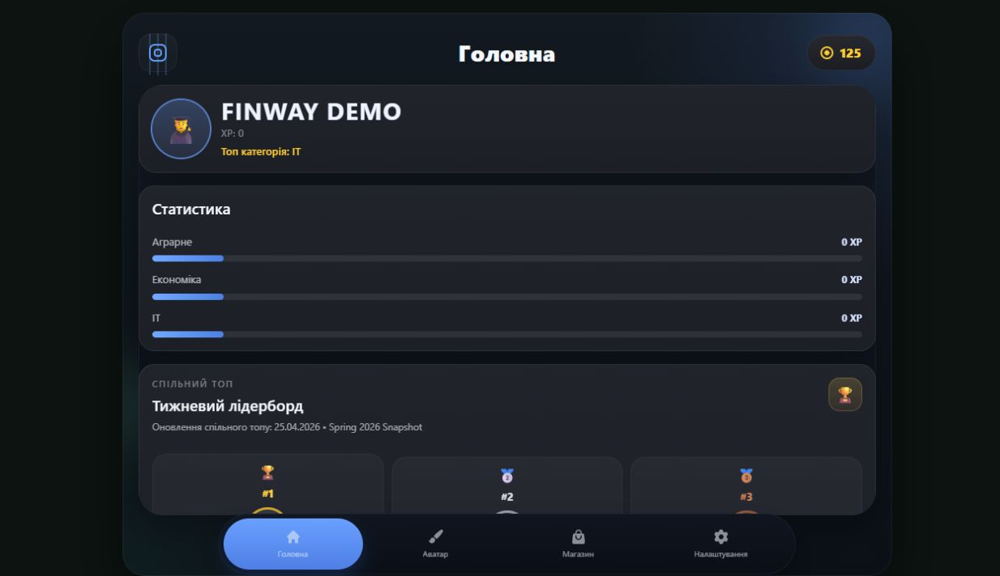
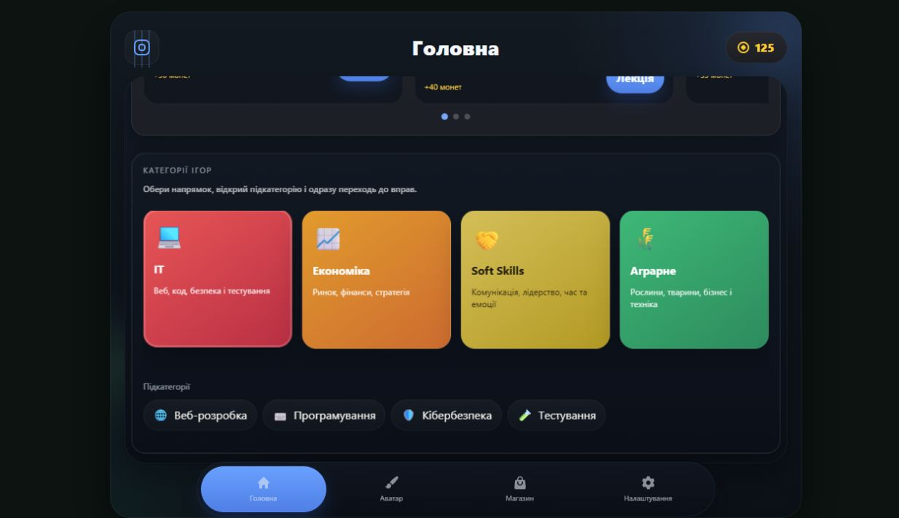
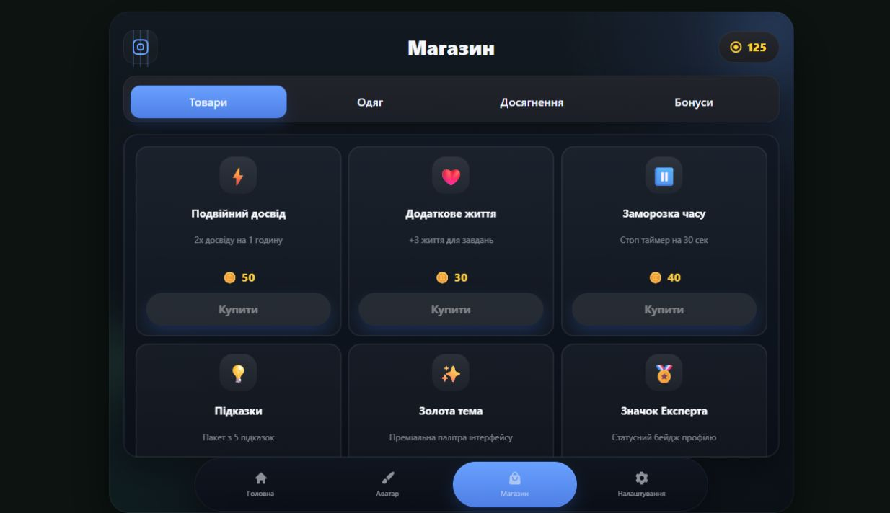
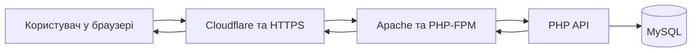

# FinWay

**Навчання через короткі уроки, практику та гру.**

FinWay — навчальна вебплатформа, у якій короткі пояснення переходять у практичні завдання, а результати навчання відображаються в особистому прогресі. Каталог тем, мініігри, персонаж і магазин створюють спільний простір для навчання невеликими кроками.

[Відкрити FinWay](https://techlifeacademys.pp.ua/) · [Запитання та пропозиції](https://github.com/adminproxmox-afk/app/issues)

**Навігація:** [Ідея](#ідея-платформи) · [Можливості](#ключові-можливості) · [Навчальні напрями](#навчальні-напрями) · [Екрани](#основні-екрани-finway) · [Сценарій навчання](#шлях-користувача) · [Технології](#стек-технологій) · [Команда](#команда)

## Головна сторінка

Головний екран об’єднує профіль, досвід, статистику напрямів, рейтинг і перехід до навчального каталогу. Нижня панель пов’язує його з персонажем, магазином і налаштуваннями.

*На скриншотах головної сторінки, каталогу й магазину використано демонстраційний профіль FinWay Demo в ізольованій копії застосунку. Вони показують реальний інтерфейс без персональних даних користувачів.*

## Ідея платформи

FinWay допомагає пов’язати пояснення з дією. Замість переходів між окремим матеріалом, вправою та записом результатів користувач знаходить їх у межах одного навчального середовища: обирає тему, читає коротку базу, виконує завдання та повертається до свого прогресу.

Основний навчальний цикл:

**Обрати тему → зрозуміти основу → спробувати на практиці → отримати зворотний зв’язок → продовжити навчання.**

Гейміфікація робить цей цикл помітним. XP, рівні, ігрові монети та персоналізація персонажа дають користувачу додаткову мотивацію повертатися до вправ. Зміст завдання залишається головним: нагорода супроводжує навчання, а перевірка результату допомагає зрозуміти помилки.

Платформа орієнтована на учнів, студентів і всіх, хто хоче знайомитися з різними темами через короткі інтерактивні заняття. Формат підходить для самостійної практики та ознайомлення з новим напрямом. FinWay також є командним навчальним проєктом, у якому поєднані веброзробка, дизайн, база даних та експлуатація серверного середовища.

## Ключові можливості

- **Особистий акаунт.** Реєстрація, вхід і профіль для роботи зі своїм прогресом.
- **Каталог навчання.** Напрями, підкатегорії та короткі пояснення до завдань.
- **Практика у форматі мініігор.** Інтерактивні вправи, перевірка відповідей і проходження рівнів; HTML Crash Course містить конструктор сторінки та її попередній перегляд.
- **Ігровий прогрес.** Досвід, рівні, історія активності та показники за навчальними напрямами.
- **Персонаж і магазин.** Персоналізація персонажа та придбання внутрішніх предметів за ігрові монети.
- **Налаштування інтерфейсу.** Світла й темна теми, українська та англійська мови, параметри звуку.
- **Вебформат.** Доступ через браузер та адаптивні екрани для комп’ютера й телефона.
- **Зворотний зв’язок під час практики.** Перевірка відповіді або зібраної структури, пояснення наступного кроку та можливість повторити спробу в ігрових сценаріях.
- **Зручне перемикання між розділами.** Головна сторінка, аватар, магазин і налаштування доступні через спільну нижню навігацію.

## Навчальні напрями

Каталог має чотири основні напрями. Усередині кожного є підкатегорії, навчальні матеріали та картки ігрових сценаріїв.

| Напрям | Підкатегорії | Зміст навчання |
| --- | --- | --- |
| **IT** | Веброзробка, програмування, кібербезпека, тестування | Структура вебсторінок, логіка програм, розпізнавання загроз і перевірка якості продукту. |
| **Економіка** | Фінансова грамотність, підприємництво, маркетинг, інвестиції | Бюджет, ресурси, бізнесові рішення, попит і робота з економічними сценаріями. |
| **Soft Skills** | Комунікація, лідерство, тайм-менеджмент, емоційний інтелект | Взаємодія з людьми, командні рішення, планування часу та розуміння емоцій. |
| **Аграрне** | Рослинництво, тваринництво, агробізнес, техніка та інновації | Вибір дій у господарстві, догляд, планування робіт і використання технологій. |

Перелік відображає структуру поточного каталогу. Рівень готовності окремих вправ відрізняється: частина представлена інтерактивними сценаріями та демонстраційними завданнями, інші мають окремий ігровий екран. Детальний приклад такого екрана — HTML Crash Course.

## Основні екрани FinWay

### Головна та особистий прогрес

Головна сторінка допомагає зорієнтуватися після входу. На ній користувач бачить свій профіль, баланс ігрових монет, загальний XP та статистику за навчальними напрямами. Окремі блоки показують популярні ігри та каталог, з якого можна перейти до конкретної теми.

Прогрес поданий кількома способами:

- **XP** відображає накопичений досвід.
- **Рівень персонажа** пов’язаний із розвитком ігрового профілю.
- **Показники напрямів** допомагають побачити, яким темам користувач приділяє увагу.
- **Історія активності** зберігає відомості про нещодавні ігрові результати.
- **Лідерборд** показує порівняльне представлення результатів із перемиканням категорій.

У поточному прототипі спільний лідерборд використовує підготовлений демонстраційний snapshot. Він показує вигляд рейтингу; його значення не є підтвердженим поточним рейтингом усіх користувачів сервера.

### Каталог і вибір заняття

Каталог організований від загального до конкретного: **напрям → підкатегорія → гра або вправа**. Наприклад, у напрямі IT можна обрати веброзробку, а всередині неї — HTML Crash Course.

Картки містять назву, короткий опис, орієнтир тривалості та передбачену нагороду. Ці дані допомагають зрозуміти формат заняття до відкриття. Кнопка «Лекція» знайомить із навчальною основою та логікою вправи.

Тривалість, рейтинг і нагороди на картках є параметрами навчального каталогу. Вони не означають виміряну тривалість проходження кожним користувачем або незалежні відгуки про курс.

### Навчальний матеріал і практика

Перед вправою користувач може прочитати коротке пояснення: що потрібно знати, як побудоване завдання і який результат очікується. Це допомагає перейти до практики з розумінням мети, а не лише натискати варіанти відповіді.

У різних сценаріях практика може мати вигляд вибору відповіді, ухвалення рішення або складання структури з блоків. Користувач отримує зворотний зв’язок і може продовжити проходження чи повернутися до завдання.

### HTML Crash Course

HTML Crash Course — окрема навчальна гра з десятьма рівнями, у якій користувач складає HTML-документ із блоків і бачить результат своєї роботи. Екран поділено на чотири робочі частини:

| Частина екрана | Що робить користувач |
| --- | --- |
| **Завдання** | Читає умову поточного рівня, підказку та перелік потрібних тегів. |
| **Блоки** | Обирає HTML-теги, доступні для цього завдання. |
| **Робоче поле** | Розміщує елементи та формує їхню вкладеність. |
| **Preview і код** | Переглядає результат і структуру документа. |

Кнопка «Перевірити» запускає перевірку зібраного рішення. Перше завдання знайомить із каркасом документа: `<html>`, `<head>`, `<title>` і `<body>`. Наступні рівні поступово розширюють практику, зберігаючи зв’язок між HTML-структурою та її відображенням.

### Персонаж і персоналізація

Персонаж пов’язує навчальний профіль з ігровою частиною платформи. В інтерфейсі передбачені категорії шкіри, волосся, аксесуарів, одягу, штанів, взуття та ефектів. Користувач може переглядати варіанти оформлення й працювати зі своїм гардеробом.

Персоналізація дає ігровим нагородам зрозуміле застосування: вони пов’язані з вибором оформлення та предметів. Відображення окремих візуальних елементів також залежить від доступності їхніх графічних ресурсів.

### Магазин, бонуси та досягнення

Магазин об’єднує внутрішні предмети й пов’язані з ними ігрові розділи:

- **Товари** — каталог предметів із назвою, описом і ціною.
- **Одяг** — елементи оформлення персонажа та гардероба.
- **Досягнення** — цілі, пов’язані з ігровою активністю, покупками та колекцією.
- **Бонуси** — отримання щоденної нагороди та перегляд історії покупок.

Монети є внутрішньою ігровою валютою для нагород і предметів. Їхнє призначення — підтримувати мотивацію та персоналізацію профілю. В описах каталогу є підсилення, життя, підказки та інші предмети; застосування конкретного ефекту залежить від реалізації відповідної гри.

### Профіль і налаштування

Налаштування об’єднують дані акаунта й параметри взаємодії з платформою. Тут користувач працює з відображуваним ім’ям, тегом профілю, поштою, описом про себе та іншими полями, доступними в інтерфейсі.

Для зручності передбачені світла й темна теми, українська та англійська мови, параметри звуку й музики. Зміна пароля належить до керування акаунтом, а вихід завершує поточну сесію. Нижня навігація допомагає повернутися до навчання з інших основних розділів.

## Шлях користувача

1. **Увійти до платформи.** Створити акаунт або використати свій логін і пароль.
2. **Зорієнтуватися на головній.** Переглянути профіль, статистику та доступні напрями.
3. **Обрати тему.** Відкрити напрям, підкатегорію та потрібну картку заняття.
4. **Ознайомитися з основою.** Прочитати короткий матеріал і правила вправи.
5. **Виконати завдання.** Пройти інтерактивний сценарій або окрему мінігру.
6. **Перевірити результат.** Отримати зворотний зв’язок і за потреби повторити спробу.
7. **Продовжити розвиток.** Переглянути прогрес, перейти до наступної теми або скористатися ігровими розділами.

Наприклад, користувач обирає **IT → Веброзробка → HTML Crash Course**, знайомиться з умовою, збирає каркас сторінки та перевіряє правильність вкладеності тегів. З кожним рівнем завдання додає нові елементи до вже зрозумілої основи.

## Як влаштована платформа

FinWay складається з браузерного інтерфейсу, серверного API та бази даних. Інтерфейс показує навчальні екрани й обробляє взаємодію, PHP API працює з обліковими записами та даними, а MySQL зберігає пов’язані сутності.

Для користувача це означає спільний акаунт і пов’язані екрани: дані профілю, стан персонажа та навчальна активність належать одному користувачу, а запити до серверних функцій проходять через API.

### Дані та їхній зв’язок

| Група даних | Що зберігає |
| --- | --- |
| Облікові записи та сесії | Користувачів, стан акаунта та авторизовані сесії. |
| Профілі й налаштування | Відображувані дані профілю, мову, тему та інші параметри. |
| Навчальний контент | Категорії, курси, модулі та уроки. |
| Навчальна активність | Проходження уроків і відомості про ігрові сесії. |
| Персонажі | Рівень, досвід, баланс та стан ігрового персонажа. |
| Магазин і покупки | Каталог предметів, придбання та записи руху ігрової валюти. |
| Досягнення | Опис цілей і зв’язки досягнень із користувачами. |

Модель MySQL містить ці групи сутностей; частина поточного клієнтського каталогу та демонстраційних ігрових даних також описана у JavaScript і JSON. Наявність таблиці в схемі не означає, що всі пов’язані механіки вже мають завершений користувацький сценарій.

### Доступ і захист акаунта

Сервер використовує сесії для перевірки авторизованого доступу. Паролі зберігаються як хеші, а токен сесії передається через HttpOnly cookie. Захищені операції перевіряють стан сесії та акаунта; зміна пароля відкликає попередні сесії. Для автентифікованих змін застосовується перевірка CSRF-токена, а зовнішній вебдоступ працює через HTTPS.

Ці механізми стосуються акаунтів і доступу. Правила нарахування нагород, перевірка ігрових результатів та узгодженість усіх операцій із предметами розвиваються разом із прикладною частиною платформи.

## Стек технологій

| Частина | Технології та призначення |
| --- | --- |
| Інтерфейс | HTML5, CSS3, JavaScript — сторінки, інтерактивність і логіка навчальних екранів. |
| Бібліотеки інтерфейсу | Bootstrap — компоненти та оформлення; GSAP — анімації; Swiper — слайдери; Howler.js — звук. |
| Серверна частина | PHP та JSON API — облікові записи, сесії й обмін даними з клієнтом. |
| База даних | MySQL — користувачі, навчальні сутності, прогрес, персонажі, предмети та транзакції ігрової валюти. |
| Вебінфраструктура | Apache, PHP-FPM і Cloudflare — обробка запитів, доступ за доменом та HTTPS. |
| Контроль якості | GitHub Actions, Python і перевірки PHP/JavaScript — автоматизована перевірка серверної частини та пакета релізу. |

## Поточний стан і розвиток

FinWay є навчальним прототипом, що розвивається. У ньому поєднані облікові записи, серверне збереження даних, навчальний каталог, інтерактивні сценарії, окрема HTML-гра та екрани ігрового профілю. Готовність конкретних механік залежить від розділу.

Автоматизовані перевірки охоплюють реєстрацію, сесії, зміну пароля, обмеження доступу, готовність бази даних і поведінку пакета релізу. Вони підтримують роботу серверної частини; перевірка всіх навчальних сценаріїв та ігрового балансу потребує окремої предметної роботи.

Основні напрями подальшого розвитку:

- Розширення навчальних матеріалів і повноцінних інтерактивних вправ.
- Узгодження XP, монет і досягнень із результатами кожної гри.
- Поглиблення серверної перевірки ігрових результатів, нагород і володіння предметами.
- Перехід від демонстраційного рейтингу до спільного рейтингу за підтвердженими даними.
- Поліпшення графічних ресурсів, доступності та роботи на різних екранах.
- Розвиток аналітики навчання, спостереження за сервісом і резервного зберігання.

Ці пункти описують розвиток проєкту й не подаються як уже завершені можливості. Кнопки зовнішніх провайдерів входу в інтерфейсі також не означають готової серверної інтеграції Google або Telegram.

## Команда

| Учасник | Роль | Напрям відповідальності |
| --- | --- | --- |
| С. Данііл | Infrastructure / Backend / Security | Серверна інфраструктура, інтеграція backend, доступ, безпека та експлуатація. |
| Ч. Юрій | Frontend & Backend / Application Developer | Інтерфейс і прикладна логіка застосунку. |
| Б. Вадим | UI/UX & Game Designer | Користувацький досвід, візуальна концепція та правила гейміфікації. |
| П. Володимир | Database / QA / Game Systems Engineer | Модель бази даних, перевірка даних і якості, ігрові системи. |

Межі ролей перетинаються в інтеграції: інтерфейс звертається до API, API працює з моделлю даних, а правила гейміфікації визначають зміст винагород і перевірок. Узгоджені контракти між цими частинами потрібні для цілісного навчального досвіду.

## Ліцензія та зв’язок

Окрему ліцензію до репозиторію наразі не додано.

Для повідомлень про помилки, запитань і пропозицій використовуйте [GitHub Issues](https://github.com/adminproxmox-afk/app/issues). Репозиторій проєкту — [adminproxmox-afk/app](https://github.com/adminproxmox-afk/app).
