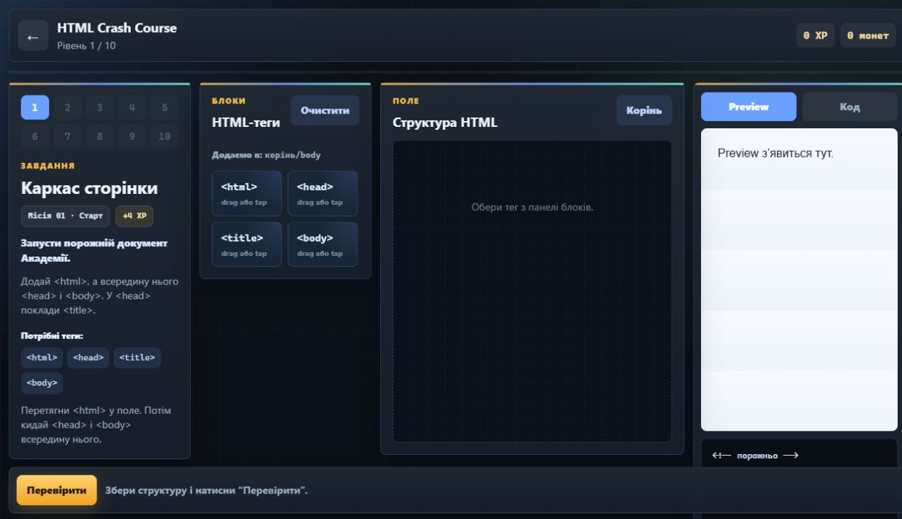

# FinWay

**Навчання через короткі уроки, практику та гру.**

FinWay — навчальна вебплатформа, що поєднує матеріали для самостійного навчання, інтерактивні завдання та ігровий прогрес. Користувач обирає напрям, знайомиться з темою, практикується й розвиває свого персонажа за допомогою досвіду та внутрішніх нагород.

[Відкрити FinWay](https://techlifeacademys.pp.ua/) · [Запитання та пропозиції](https://github.com/adminproxmox-afk/app/issues)

## Інтерфейс

HTML Crash Course — приклад практичного навчання у FinWay: користувач складає структуру вебсторінки з HTML-блоків, переглядає результат і перевіряє виконане завдання.

## Для чого потрібен FinWay

Платформа допомагає перейти від ознайомлення з темою до самостійної практики в одному інтерфейсі. Короткі завдання дають змогу навчатися поступово, а рівні, досвід і нагороди роблять просування помітним.

Каталог об’єднує чотири напрями: **IT, економіку, soft skills та аграрну тематику**. Матеріали й ігрові сценарії згруповані за підкатегоріями, щоб користувач міг обрати потрібну тему.

## Ключові можливості

- **Особистий акаунт.** Реєстрація, вхід і профіль для роботи зі своїм прогресом.
- **Каталог навчання.** Напрями, підкатегорії та короткі пояснення до завдань.
- **Практика у форматі мініігор.** Інтерактивні вправи, перевірка відповідей і проходження рівнів; HTML Crash Course містить конструктор сторінки та її попередній перегляд.
- **Ігровий прогрес.** Досвід, рівні, історія активності та показники за навчальними напрямами.
- **Персонаж і магазин.** Персоналізація персонажа та придбання внутрішніх предметів за ігрові монети.
- **Налаштування інтерфейсу.** Світла й темна теми, українська та англійська мови, параметри звуку.
- **Вебформат.** Доступ через браузер та адаптивні екрани для комп’ютера й телефона.

FinWay розвивається як навчальний командний проєкт. Частина ігрових сценаріїв представлена у демонстраційному форматі; наповнення каталогу та глибина механік залежать від конкретного розділу.

## Як це працює

1. Користувач створює акаунт або входить до свого профілю.
2. Обирає напрям і тему в каталозі.
3. Читає короткий навчальний матеріал та умови завдання.
4. Виконує вправу або проходить мінігру, отримуючи зворотний зв’язок.
5. Переглядає свій прогрес і використовує ігрові нагороди для розвитку персонажа.

Наприклад, у **HTML Crash Course** перше завдання знайомить із каркасом документа. Потрібно розмістити `<html>`, `<head>`, `<title>` і `<body>` у правильній ієрархії, переглянути структуру та натиснути «Перевірити». Наступні рівні поступово розширюють роботу з HTML.

## Стек технологій

| Частина | Технології та призначення |
| --- | --- |
| Інтерфейс | HTML5, CSS3, JavaScript — сторінки, інтерактивність і логіка навчальних екранів. |
| Бібліотеки інтерфейсу | Bootstrap — компоненти та оформлення; GSAP — анімації; Swiper — слайдери; Howler.js — звук. |
| Серверна частина | PHP та JSON API — облікові записи, сесії й обмін даними з клієнтом. |
| База даних | MySQL — користувачі, навчальні сутності, прогрес, персонажі, предмети та транзакції ігрової валюти. |
| Вебінфраструктура | Apache, PHP-FPM і Cloudflare — обробка запитів, доступ за доменом та HTTPS. |
| Контроль якості | GitHub Actions, Python і перевірки PHP/JavaScript — автоматизована перевірка серверної частини та пакета релізу. |

## Команда

| Учасник | Роль | Напрям відповідальності |
| --- | --- | --- |
| С. Данііл | Infrastructure / Backend / Security | Серверна інфраструктура, інтеграція backend, доступ, безпека та експлуатація. |
| Ч. Юрій | Frontend & Backend / Application Developer | Інтерфейс і прикладна логіка застосунку. |
| Б. Вадим | UI/UX & Game Designer | Користувацький досвід, візуальна концепція та правила гейміфікації. |
| П. Володимир | Database / QA / Game Systems Engineer | Модель бази даних, перевірка даних і якості, ігрові системи. |

## Ліцензія та зв’язок

Окрему ліцензію до репозиторію наразі не додано.

Для повідомлень про помилки, запитань і пропозицій використовуйте [GitHub Issues](https://github.com/adminproxmox-afk/app/issues). Репозиторій проєкту — [adminproxmox-afk/app](https://github.com/adminproxmox-afk/app).
